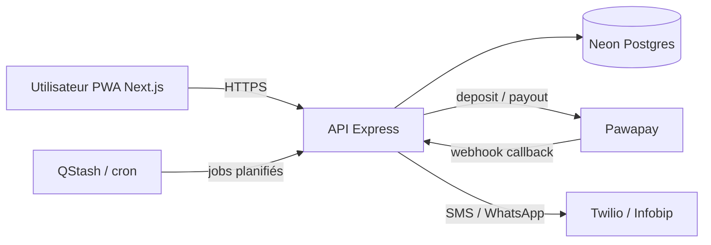

# Technical Requirement Document (TRD) : Likelemba-app

> Version 2 — remplace la v1. Le schéma complet est dans `server/src/db/schema.ts`.

## 1. Stack technique

| Couche            | Choix                                                              |
| ----------------- | ------------------------------------------------------------------ |
| Frontend          | Next.js (App Router, TypeScript), Tailwind CSS, shadcn/ui, PWA     |
| Backend           | Node.js, Express, TypeScript                                       |
| Base de données   | PostgreSQL sur Neon (serverless)                                   |
| ORM               | Drizzle ORM, driver `neon-serverless` (Pool WebSocket)             |
| Paiements         | Pawapay (MTN MoMo et Airtel Money)                                 |
| Tâches planifiées | Upstash QStash (recommandé) ou `node-cron` en instance unique      |
| SMS / WhatsApp    | Twilio ou Infobip (à choisir selon la couverture Congo et le coût) |
| Validation        | Zod                                                                |

## 2. Architecture



Principes :

- L'API est la seule à parler à Pawapay et à la base. Le frontend n'a aucun secret.
- Toute opération financière est **idempotente** et **tracée** en base.
- Les jobs planifiés appellent des endpoints internes protégés, ou s'exécutent dans le même processus selon le choix cron.

## 3. Base de données

### 3.1 Driver Neon

`neon-http` ne supporte pas les transactions SQL. Or elles sont nécessaires pour réordonner les membres, valider une cotisation et clôturer un cycle de façon atomique. On utilise donc le driver WebSocket :

```ts
import { Pool, neonConfig } from "@neondatabase/serverless";
import { drizzle } from "drizzle-orm/neon-serverless";
import ws from "ws";

neonConfig.webSocketConstructor = ws;

const pool = new Pool({ connectionString: process.env.DATABASE_URL });
export const db = drizzle({ client: pool });
```

Dépendances : `ws`, `@types/ws` (dev), `bufferutil` (optionnel, perf).

### 3.2 Tables

| Table           | Rôle                                                                                      |
| --------------- | ----------------------------------------------------------------------------------------- |
| `users`         | Comptes : nom, téléphone E.164, opérateur MoMo, vérification du numéro                    |
| `groups`        | Groupes : montant entier en XAF, fréquence, date de début, statut                         |
| `group_invites` | Liens d'invitation : code, expiration, usages, révocation                                 |
| `group_members` | Appartenance, rôle, statut, ordre de passage (null avant validation)                      |
| `cycles`        | Une échéance par tour : numéro, bénéficiaire, date limite, statut                         |
| `contributions` | Cotisation attendue par membre et par cycle (base du suivi Payé / En attente / En retard) |
| `transactions`  | Opérations Pawapay : type `contribution` ou `payout`, statut, callback brut               |
| `reminders`     | Rappels envoyés, pour garantir l'idempotence du cron                                      |

### 3.3 Règles d'intégrité

- Montants en `integer` (XAF sans centimes). Si une autre devise est ajoutée plus tard, passer aux unités mineures.
- `transactions.id` est envoyé à Pawapay comme `depositId` ou `payoutId`.
- Index unique partiel : une seule transaction non échouée par cotisation, et un seul payout non échoué par cycle.
- Pas de `ON DELETE CASCADE` sur les données financières : un groupe se passe en `cancelled`, il ne se supprime pas.
- Réordonner les membres : renuméroter dans une transaction avec des valeurs temporaires, à cause de l'unicité (groupe, ordre).
- « En retard » est calculé (`pending` et `due_date` dépassée), jamais stocké.

## 4. Flux techniques

### 4.1 Authentification (téléphone + OTP)

1. `POST /auth/otp/request` : génère un code, le stocke haché avec expiration (5 min), l'envoie par SMS. Limitation de débit par numéro et par IP.
2. `POST /auth/otp/verify` : vérifie le code, renseigne `phone_verified_at`, ouvre la session (JWT court + refresh token en cookie `HttpOnly`).
3. Aucun mot de passe. Un compte non vérifié ne peut ni rejoindre un groupe ni payer.

La table de stockage des OTP (ou un Redis/Upstash) reste à ajouter au schéma.

### 4.2 Activation d'un groupe et génération du calendrier

Dans **une seule transaction SQL** :

1. Vérifier que le groupe est en `draft` et que tous les membres actifs ont un `payout_order`.
2. Passer le groupe en `active`.
3. Créer N cycles : date limite = date de début + k × fréquence ; bénéficiaire = membre dont l'ordre est k.
4. Créer les `contributions` (une par membre et par cycle) avec le montant du groupe.

### 4.3 Cotisation (entrant)

1. `POST /contributions/:id/pay` : vérifie que l'utilisateur est le membre concerné et que la cotisation est `pending`.
2. Crée une `transaction` (`type = contribution`, `status = pending`), puis appelle Pawapay `deposit` avec `depositId = transactions.id`. L'index unique partiel bloque tout double prélèvement.
3. Pawapay envoie la demande USSD au téléphone du membre.
4. Le webhook met à jour la transaction. Si `successful`, dans une transaction SQL : passer la contribution en `paid` (avec `paid_at`) ; si toutes les contributions du cycle sont `paid`, passer le cycle en `collected`.
5. Le frontend interroge `GET /contributions/:id` toutes les quelques secondes (ou SSE) pour afficher le résultat.

### 4.4 Distribution de la cagnotte (sortant)

1. Déclenchée quand un cycle passe en `collected` (par le webhook ou par le job de réconciliation).
2. Crée une `transaction` (`type = payout`, `userId` = bénéficiaire, `phone` et `provider` du bénéficiaire) ; l'index unique partiel garantit un seul payout actif par cycle.
3. Appelle Pawapay `payout` avec `payoutId = transactions.id`.
4. Sur `successful` : cycle en `paid_out`, `payout_completed_at` renseigné ; si c'est le dernier cycle, groupe en `completed`.
5. Sur `failed` : alerte à l'admin, nouvelle tentative manuelle ou automatique limitée.

### 4.5 Webhooks Pawapay

- Endpoint public dédié, sans authentification utilisateur, mais **avec vérification de la signature** du callback selon la documentation Pawapay.
- Traitement **idempotent** : le même webhook peut arriver plusieurs fois ; on ignore s'il n'apporte aucun changement d'état.
- Le corps brut est conservé dans `transactions.raw_callback`.
- Répondre `200` rapidement ; le travail lourd (notifications) est mis en file.

### 4.6 Réconciliation

Job toutes les 5 à 10 minutes : pour les transactions restées en `pending` ou `processing` depuis plus de N minutes, interroger Pawapay (statut du dépôt ou du payout) et appliquer le même traitement que pour un webhook. Cela rattrape les webhooks perdus.

### 4.7 Rappels

- Job quotidien, exécuté à une heure fixe en **Africa/Brazzaville (UTC+1)**.
- Sélection : contributions `pending` dont le cycle a `due_date` dans exactement 7 jours (J-7), 1 jour (J-1) ou dépassée (retard).
- Avant envoi : insertion dans `reminders` avec la contrainte d'unicité (contribution, type, canal). Si l'insertion échoue, le rappel a déjà été envoyé.
- Canal par défaut : SMS ; repli sur WhatsApp ou push selon la configuration.
- `node-cron` n'est adapté qu'avec une instance unique et un serveur qui ne redémarre pas souvent ; QStash est plus robuste.

## 5. API (aperçu)

| Méthode    | Route                                                  | Rôle                                             |
| ---------- | ------------------------------------------------------ | ------------------------------------------------ |
| POST       | `/auth/otp/request`, `/auth/otp/verify`                | Connexion par OTP                                |
| GET        | `/me`                                                  | Profil                                           |
| POST / GET | `/groups`, `/groups/:id`                               | Créer, consulter un groupe                       |
| POST       | `/groups/:id/invites`                                  | Générer un lien d'invitation                     |
| POST       | `/invites/:code/join`                                  | Rejoindre via un lien                            |
| PUT        | `/groups/:id/order`                                    | Définir l'ordre de passage (admin)               |
| POST       | `/groups/:id/activate`                                 | Valider l'ordre et générer le calendrier (admin) |
| GET        | `/groups/:id/cycles`                                   | Calendrier et statuts de paiement                |
| POST       | `/contributions/:id/pay`                               | Lancer un paiement                               |
| POST       | `/webhooks/pawapay`                                    | Callbacks Pawapay                                |
| POST       | `/internal/jobs/reminders`, `/internal/jobs/reconcile` | Jobs planifiés (secret requis)                   |

## 6. Sécurité

- Validation stricte de toutes les entrées avec Zod (corps, paramètres, requêtes).
- Autorisation par rôle : seul l'admin du groupe peut modifier l'ordre, activer ou annuler ; un membre ne paie que ses propres cotisations.
- Secrets (clés Pawapay, `DATABASE_URL`, clés SMS, secret JWT) dans des variables d'environnement, jamais dans le dépôt ; `.env` dans `.gitignore`.
- Limitation de débit sur l'OTP et sur les routes de paiement.
- Cookies `HttpOnly`, `Secure`, `SameSite` ; CORS restreint au domaine du frontend.
- Journalisation d'audit des opérations financières ; aucune donnée sensible (OTP, tokens) dans les logs.
- Numéros de téléphone normalisés en E.164 avant tout enregistrement.

## 7. Variables d'environnement

```
DATABASE_URL=
JWT_SECRET=
PAWAPAY_API_TOKEN=
PAWAPAY_BASE_URL=            # sandbox puis production
PAWAPAY_CALLBACK_SECRET=     # selon le mécanisme de signature retenu
SMS_PROVIDER_KEY=
QSTASH_TOKEN=                # si QStash
INTERNAL_JOBS_SECRET=
APP_BASE_URL=
```

## 8. Qualité et exploitation

- **Tests** : unitaires sur les règles métier (génération du calendrier, détection de retard) ; intégration sur les flux Pawapay avec le sandbox ; tests de concurrence sur les double-paiements.
- **Observabilité** : logs structurés avec identifiant de transaction, alertes sur les paiements bloqués en `processing`, tableau de bord des taux d'échec.
- **Environnements** : développement, staging (Pawapay sandbox, branche Neon dédiée) et production.
- **Migrations** : `drizzle-kit generate` puis `migrate` en CI, jamais `push` en production.
- **Sauvegardes** : utiliser la restauration à un instant donné de Neon et tester la procédure.

## 9. Points à vérifier avant de coder

1. Couverture de Pawapay pour MTN et Airtel Congo : entrant et sortant, plafonds, devises, codes opérateur exacts.
2. Mécanisme précis de signature des callbacks et délais de relance de Pawapay.
3. Fournisseur SMS le plus fiable et le moins cher pour le Congo (Twilio ou Infobip) et conditions pour WhatsApp Business.
4. Cadre réglementaire pour collecter et redistribuer des fonds de tiers.
5. Choix entre QStash et `node-cron` selon l'hébergeur du backend.
